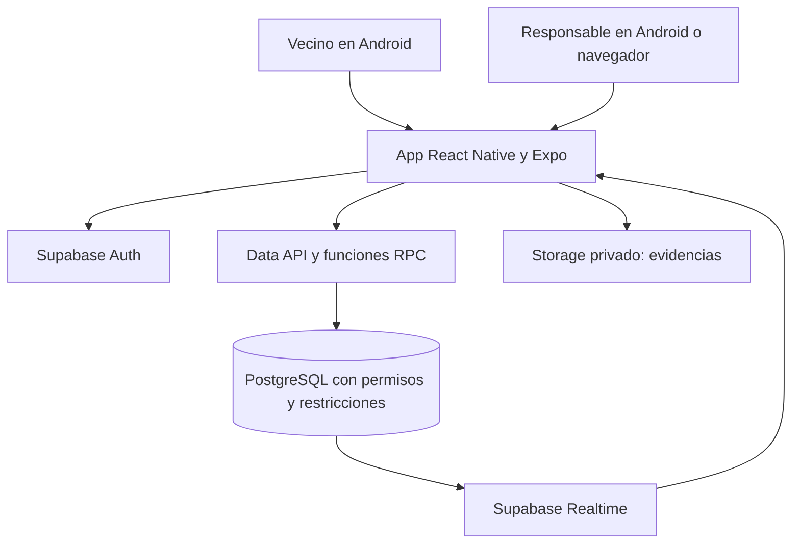
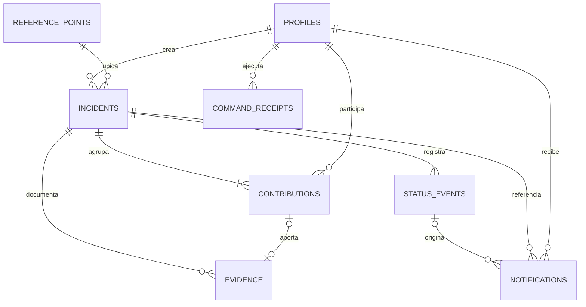

# Arquitectura de software — Barrio Limpio

Versión: 0.2. Fecha: 31/10/2026. Requisitos de referencia: [REQUERIMIENTOS.md](REQUERIMIENTOS.md). La ampliación geográfica y las diferencias respecto de la línea base siguiente se detallan en [UBICACION.md](UBICACION.md). Código y migración preparados; despliegue geográfico pendiente en el proyecto real.

## 1. Decisiones principales

- **ADR-01, aplicación móvil:** React Native con Expo y TypeScript. Android es el destino principal; navegador es una superficie secundaria de pruebas. Expo Go permite la demostración inicial, pero un APK propio exige un proceso de compilación adicional. No se promete iOS probado.
- **ADR-02, servicios administrados:** Supabase Free concentra Auth, PostgreSQL, Storage y Realtime. Se evita desarrollar un servidor independiente para el piloto.
- **ADR-03, duplicados:** coordenadas confirmadas, búsqueda a 30 m en PostgreSQL mediante Haversine, sin excluir categorías distintas. Confirmación humana y fusión administrativa con archivo de originales. PostGIS y reconocimiento de imágenes no son dependencias del piloto. Los puntos de referencia se conservan para compatibilidad con reportes anteriores.
- **ADR-04, avisos:** almacenamiento persistente más actualización en tiempo real dentro de la app. No se implementan FCM, SMS, WhatsApp ni correo operativo en esta entrega.
- **ADR-05, integridad:** las operaciones que afectan varias entidades se ejecutan en funciones PostgreSQL llamadas mediante RPC. La app no controla la transición de estados con actualizaciones sueltas.
- **ADR-06, evidencias:** fotografías en un bucket privado; rutas en la base de datos. Compresión y conversión compatibles se realizan en el cliente, sin depender del servicio de transformaciones de imágenes.

Son decisiones para el plazo y el piloto acordados. No implican que la infraestructura ya esté configurada.

La versión 0.2 añade `latitude`, `longitude`, `district`, `accuracy_m`, `location_source`, `merged_into_id`, `previous_incident_id` y la tabla protegida `location_events`. Las funciones `browse_incidents`, `nearby_matches`, `create_geo_incident`, `locate_legacy_incident` y `merge_incidents` concentran las nuevas reglas; el servidor retira el permiso de creación del cliente anterior para impedir casos nuevos sin coordenadas. Las secciones históricas de diseño por puntos deben interpretarse junto con la ampliación enlazada.

## 2. Contexto y componentes



La sesión identifica al usuario. El cliente usa la clave publicable del proyecto y el token de sesión; la autorización efectiva se impone en el servidor. PostgreSQL conserva las incidencias y avisos. Storage conserva los archivos. Realtime informa que hay cambios y la app vuelve a consultar los datos autorizados.

La entrega no incluye un sistema municipal externo ni envío automático a recolectores que no tengan una cuenta y un acuerdo de participación.

## 3. Organización propuesta del código

```text
mobile/src/
  app/              Rutas de Expo Router: acceso, pestañas y detalle de incidencia
  screens/          Pantallas reutilizables, como el listado de incidencias
  components/       TarjetaIncidencia, EtiquetaEstado, SelectorFoto, FormularioError
  domain/           tipos, catálogos, validaciones y reglas de presentación
  services/         auth, incidencias, aportes, evidencias y notificaciones
  lib/              cliente Supabase y configuración pública
  hooks/            sesión, consultas y suscripciones
supabase/
  migrations/       tablas, índices, políticas, funciones y publicación Realtime
docs/
  REQUERIMIENTOS.md
  ARQUITECTURA.md
```

La navegación se mantendrá sencilla con una biblioteca compatible con la versión de Expo seleccionada. El estado de sesión se comparte con contexto de React; los formularios usan estado local y las consultas se encapsulan en hooks y servicios. No se requiere Redux para este alcance.

## 4. Componentes del framework a investigar

- `View`, `Text` y `StyleSheet`: composición de pantallas y estilos.
- `FlatList`: listado paginado de incidencias y avisos.
- `TextInput`, `Pressable` y `ActivityIndicator`: formularios, acciones y progreso.
- `KeyboardAvoidingView`, áreas seguras y desplazamiento: interacción en pantallas móviles.
- `expo-image-picker`: acceso a cámara y galería, permisos y cancelación.
- `expo-image-manipulator`: preparar imágenes antes de subirlas, sujeto a compatibilidad de la versión instalada.
- Hooks de React y eventos de ciclo de vida: sesión, carga y recuperación al volver a primer plano.
- Cliente JavaScript de Supabase: sesión, consultas, RPC, archivos y eventos de cambios.

La selección final de versiones y comportamiento se verificará al instalar y probar; no se copian versiones futuras o incompatibles sin comprobación.

## 5. Modelo de datos lógico

Todos los identificadores propios son UUID, las fechas persistidas son `timestamptz` del servidor y se muestran en hora de Lima. El MVP contiene un único barrio; incorporar varios barrios requerirá extender el modelo y las políticas.

### profiles

`id` (PK y FK a `auth.users`), `display_name`, `role` (`vecino` o `responsable`), `created_at`.

Los correos y contraseñas pertenecen a Auth. El cliente no puede modificar `role`. El alta administrativa prepara los perfiles. No se expone un listado de perfiles a vecinos; cada usuario puede leer el propio.

### reference_points

`id`, `name`, `reference`, `active`, `created_at`.

Catálogo administrativo de ubicaciones concretas, por ejemplo una esquina o un acceso del parque. Las coordenadas no son necesarias para el MVP; podrán añadirse para la búsqueda por distancia.

### incidents

`id`, `created_by`, `reference_point_id`, `location_text`, `description`, `problem_type`, `status`, `assigned_to` nullable, `distinct_reason` nullable, `resolution_note` nullable, `version`, `created_at`, `updated_at`, `resolved_at` nullable.

Claves foráneas a perfiles y puntos. Índice de búsqueda en `(reference_point_id, problem_type, status)` e índice de orden en `(created_at, id)`. Restricciones para catálogos, longitudes y consistencia de asignación con el estado. No se usa una restricción única absoluta por punto y tipo: puede haber dos problemas diferentes declarados explícitamente.

### contributions

`id`, `incident_id`, `user_id`, `created_at`.

Restricción `UNIQUE(incident_id, user_id)`. El creador obtiene una participación en la misma transacción de creación. El contador se calcula desde estas filas, sin incrementos arbitrarios enviados desde el cliente.

### evidence

`id`, `incident_id`, `contribution_id` nullable, `uploaded_by`, `kind` (`reporte` o `solucion`), `object_path`, `mime_type`, `byte_size`, `created_at`.

Para evidencia de reporte se exige participación correspondiente; para solución se exige responsable asignado y estado válido. Ruta única. Máximo una evidencia de reporte por aporte y una de solución por incidencia. El archivo debe existir en Storage antes de registrar su referencia.

### status_events

`id`, `incident_id`, `actor_id`, `from_status` nullable, `to_status`, `note` nullable, `created_at`.

Bitácora inmutable para clientes. El evento inicial tiene estado anterior nulo. Una proyección segura expone a vecinos estado, fecha y rol del actor, sin identificadores personales.

### notifications

`id`, `recipient_id`, `incident_id`, `status_event_id` nullable, `event_type`, `read_at` nullable, `created_at`.

La creación se deduplica por destinatario, tipo e incidencia; cada cambio de estado por destinatario y evento. Índice en `(recipient_id, read_at, created_at)`. No almacenar correos o información sensible en el texto de los avisos.

### command_receipts

`id`, `actor_id`, `client_request_id`, `operation`, `payload_hash`, `result_id`, `created_at`.

Restricción `UNIQUE(actor_id, client_request_id)`. Registra el resultado de comandos exitosos para resolver reintentos. Si se reutiliza una clave con otra operación o contenido, se rechaza. Recibo y cambios se confirman en la misma transacción; las respuestas que piden confirmar una coincidencia no consumen definitivamente el comando.



## 6. Contratos de operaciones

Las funciones reciben el token del usuario, obtienen su identidad con `auth.uid()` y comprueban el rol protegido. Nunca confían en un `user_id`, rol o fecha arbitrarios enviados por el teléfono.

- **Consultar incidencias:** filtros permitidos y paginación por fecha e identificador; devolver solo campos autorizados y cantidad agregada de participantes.
- **Buscar coincidencias:** punto y tipo; devolver incidencias pendientes o en proceso. Los resultados no acreditan que sean el mismo episodio.
- **Crear incidencia:** campos validados, clave de petición, candidatos previamente vistos y explicación cuando se declara un problema distinto. Devuelve creada, coincidencia que requiere confirmación o error.
- **Confirmar incidencia:** ID y clave de petición. Inserta participación si no existe; devuelve su ID existente en reintentos. Solo se admiten casos abiertos.
- **Adjuntar evidencia de reporte:** comprueba participación propia, archivo autorizado y cupo antes de asociarlo.
- **Aceptar incidencia:** ID, versión esperada y clave de petición. Solo responsables; asigna al actor si el caso continúa pendiente.
- **Resolver incidencia:** ID, versión esperada, observación, referencia al archivo y clave de petición. Solo responsable asignado y estado en proceso.
- **Marcar aviso leído:** solo destinatario; repetir la operación no cambia su significado.

Las operaciones de creación, aceptación y cierre insertan su bitácora y sus avisos dentro de la misma transacción. El cliente no inserta avisos ni eventos directamente.

## 7. Concurrencia y detección de duplicados

Deshabilitar un botón evita pulsaciones accidentales, pero la integridad se resuelve en servidor.

Para crear, la función obtiene un bloqueo transaccional por punto y tipo, vuelve a consultar candidatos y comprueba la decisión del usuario. Si aparece un candidato que el usuario no había visto, devuelve su información y pide confirmar. Crear otro caso exige una explicación y reconocer los candidatos vigentes. Así dos peticiones simultáneas no crean el segundo caso inadvertidamente.

Para confirmar, una restricción única impide repetir al mismo vecino. Para aceptar y cerrar, un bloqueo de fila y la versión esperada impiden sobrescribir el resultado de otro responsable. Cada comando exitoso guarda su recibo y puede responder a un reintento sin crear otra bitácora o aviso.

No se fusionan incidencias automáticamente ni se afirma eliminar todos los duplicados. Personas que usan puntos distintos para el mismo lugar todavía pueden generar coincidencias que requieran revisión futura.

## 8. Flujo de fotografías y errores parciales

### Reporte

1. Seleccionar imagen, validar formato y procesarla en el dispositivo: dimensión máxima propuesta de 1600 píxeles en el lado mayor y límite final de 2 MB.
2. Crear o confirmar incidencia con su identificador de petición estable.
3. Subir la imagen a una ruta determinista por usuario y evidencia; no reemplazar objetos ajenos.
4. Asociar la ruta mediante la operación autorizada de evidencia.
5. Si falla la imagen, conservar la incidencia y mostrar explícitamente «Reporte guardado; fotografía pendiente de adjuntar». Reintentar solo la foto.

### Solución

1. Subir la fotografía de solución a una ruta provisional autorizada para el responsable asignado.
2. Invocar el cierre, que comprueba archivo, estado y versión y registra evidencia, transición y avisos juntos.
3. Si falla el cierre, el caso permanece en proceso y se permite reintentar con el mismo identificador.

Storage y PostgreSQL no comparten una única transacción de archivos. Si queda un archivo sin referencia tras una cancelación, intentar retirarlo con permisos propios; revisar los objetos provisionales al preparar la exposición. Una limpieza automática programada queda para una ampliación. Nunca afirmar que la subida y la fila de base de datos son atómicas.

## 9. Seguridad y límites de confianza

- Activar Row Level Security en todas las tablas expuestas y políticas de Storage. La clave publicable es configuración del cliente; una `service_role`, clave secreta o contraseña de base de datos nunca se distribuye en la app.
- Usuarios sin sesión no leen datos del piloto. Vecinos autenticados consultan incidencias y evidencias permitidas sin obtener la lista de identidades de participantes.
- Perfiles, aportes con identidad, notificaciones y recibos requieren políticas particulares; los conteos y bitácoras públicas del piloto se exponen mediante proyecciones o RPC que evitan filtraciones.
- Conceder a cada cliente únicamente las operaciones necesarias. Las mutaciones de incidencias, participantes y estados pasan por las funciones; `notifications` solo admite lectura propia y marcado de lectura controlado.
- Si una función usa `SECURITY DEFINER`, fijar `search_path`, calificar objetos, restringir `EXECUTE` a `authenticated` y comprobar identidad, rol y parámetros dentro de ella. Revocar ejecución pública por defecto.
- Bucket privado con formato y tamaño permitidos. Las políticas comprueban usuario, ruta y relación con el caso; una carpeta con un UUID no constituye autorización suficiente.
- Ver fotografías mediante URL firmada de corta duración, emitida solo tras una lectura autorizada. No guardar esas URL temporales en la base de datos.
- No registrar tokens ni contenido sensible. Las variables públicas de Expo no ocultan secretos; un archivo `.env` tampoco transforma una clave privilegiada en segura dentro del móvil.
- Los clientes no pueden asignarse roles, cambiar autorías ni borrar la bitácora. Las cuentas privilegiadas se preparan por administración fuera de la app.

## 10. Avisos y sincronización

Las filas de `notifications` son la fuente de verdad. Suscribirse a los cambios autorizados del usuario para refrescar contador y lista; configurar las tablas necesarias en la publicación de Realtime. No tratar el flujo de eventos como una cola durable ni como notificaciones del sistema operativo.

Al recuperar la conexión, iniciar sesión o volver a primer plano, consultar avisos no leídos y refrescar incidencias visibles. Cerrar las suscripciones al salir de pantalla o sesión. Si Realtime falla, mostrar reintento y conservar actualización manual.

## 11. Configuración, costo y demostración

Preparar una organización Supabase en Free y un único proyecto del piloto. Configurar tablas, restricciones, funciones, políticas y bucket mediante migraciones reproducibles. Mantener la clave publicable y URL en configuración de ejemplo sin credenciales privilegiadas.

El Free publicado incluye 500 MB de base de datos y 1 GB de archivos; puede pausar proyectos por una semana de inactividad. Mantener fotos pequeñas, páginas limitadas y suscripciones acotadas. Las transformaciones de imágenes de Storage no forman parte del Free, por eso el procesamiento se plantea en el dispositivo. Verificar proyecto activo antes de exponer.

Para la demo: teléfono Android con Expo Go, computadora con servidor de desarrollo, red accesible entre ambos y conexión a Supabase. Preparar dos vecinos, un responsable y puntos ficticios claramente identificados. Probar antes en la red de exposición; disponer de capturas o video del recorrido como respaldo, sin presentarlos como operación en vivo.

Si se exige APK, añadir configuración y compilación Android y verificar la instalación y el arranque independientes de Expo Go. No se da por realizado ni se condiciona la entrega a contratar compilaciones de pago.

## 12. Verificación y riesgos pendientes

Ejecutar PA-01 a PA-10 del documento de requisitos y registrar resultado, dispositivo y evidencia. Priorizar pruebas de autorizaciones, concurrencia y recuperación de errores de fotografías, además del recorrido funcional.

Riesgos abiertos: proveedor gratuito no disponible, permisos móviles denegados, red de exposición, diferencias entre navegador y Android, requisitos anteriores aún no revisados y ausencia de organización real receptora. La mitigación es comprobar temprano el flujo móvil, mantener avisos consultables, preparar datos de demo y no afirmar integración municipal ni validación social inexistentes.

## 13. Fuentes oficiales consultadas

Consultadas el 31/10/2026. Las reglas de negocio y el modelo propuesto son decisiones de este proyecto; los enlaces respaldan las capacidades técnicas utilizadas.

- [Expo: entorno y Expo Go](https://docs.expo.dev/get-started/set-up-your-environment/).
- [Supabase Auth con React Native](https://supabase.com/docs/guides/auth/quickstarts/react-native).
- [Supabase Storage: control de acceso](https://supabase.com/docs/guides/storage/security/access-control).
- [Supabase Realtime: cambios de PostgreSQL](https://supabase.com/docs/guides/realtime/postgres-changes).
- [Supabase: cuotas y precios](https://supabase.com/pricing).
